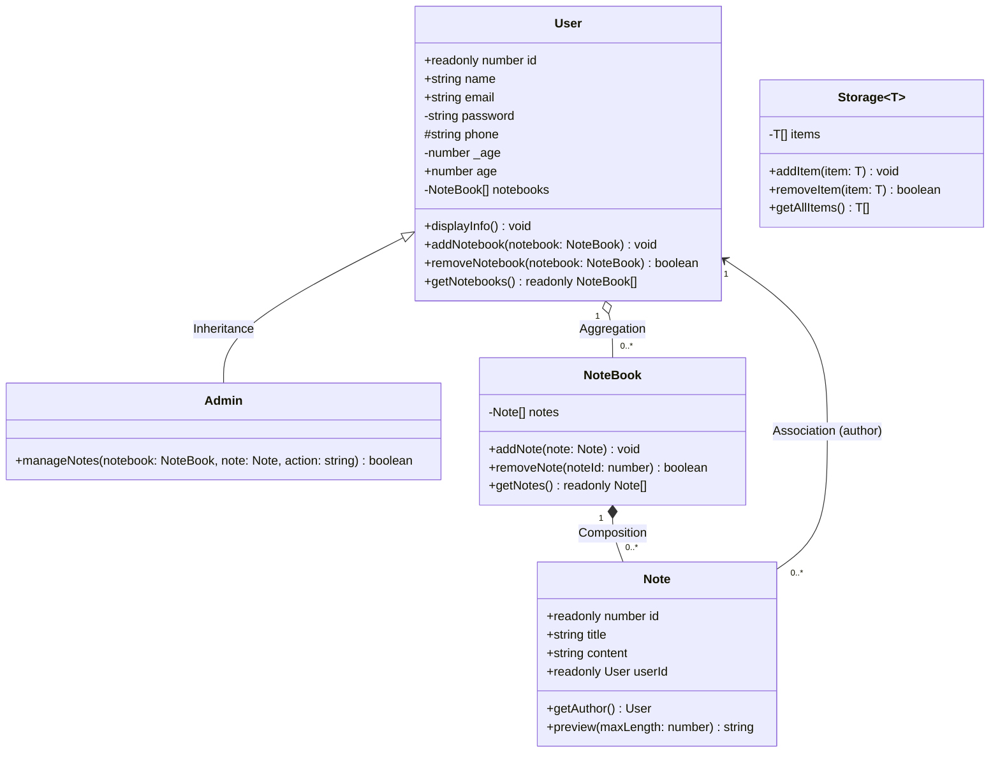

<!-- Part B - Question 1: UML Class Diagram -->
# UML Class Diagram

The editable Mermaid source is in `class-diagram.mmd`.

## UML legend

- Hollow triangle (`Admin` → `User`): **Inheritance**; Admin extends User.
- Filled diamond at `NoteBook`: **Composition**; the notebook owns zero or more Notes.
- Hollow diamond at `User`: **Aggregation**; the user references zero or more independently created NoteBooks.
- The separate **Association** between `Note` and `User` shows that each note has exactly one author and a user may author zero or more notes. It is not one of the three ownership/inheritance relationships above.

`+` is public, `-` private, and `#` protected. The multiplicities match the implementation: one notebook may contain zero or more notes; one user may reference zero or more notebooks; every note has one author.
